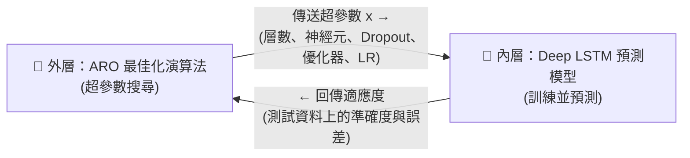

# 《以人工兔群最佳化演算法優化深度 LSTM 之股價預測》
## 簡報完整內容、數學公式推導與學術背景全解手冊

> **本手冊依據論文原文與新版 27 頁簡報整理：**
> * 原著論文：Gülmez, B. (2023). *Stock price prediction with optimized deep LSTM network with artificial rabbits optimization algorithm*. **Expert Systems with Applications**, 227, 120346.
> * DOI：[10.1016/j.eswa.2023.120346](https://doi.org/10.1016/j.eswa.2023.120346)
> * 頁碼（P01–P27）皆指新版簡報；數字已對照論文 Tables 7–11 核對。標註「論文未說明」的內容，報告時不要說成作者的做法。

---

## 目錄 (Table of Contents)
1. [研究背景與核心問題 (P01–P04)](#1-研究背景與核心問題-p01p04)
2. [資料工程與滑動視窗機制 (P05)](#2-資料工程與滑動視窗機制-p05)
3. [實驗設計與對照基準模型 (P11–P12)](#3-實驗設計與對照基準模型-p11p12)
4. [深度 LSTM 神經網路原理與數學公式 (P06–P11)](#4-深度-lstm-神經網路原理與數學公式-p06p11)
5. [人工兔群最佳化演算法 (ARO) 數學公式詳解 (P13–P17)](#5-人工兔群最佳化演算法-aro-數學公式詳解-p13p17)
6. [LSTM-ARO 整合架構與超參數搜尋空間 (P18–P19)](#6-lstm-aro-整合架構與超參數搜尋空間-p18p19)
7. [預測評估指標與數學定義 (P20)](#7-預測評估指標與數學定義-p20)
8. [實證成果、個股數據與例外分析 (P21–P23)](#8-實證成果個股數據與例外分析-p21p23)
9. [計算成本分析 (P24)](#9-計算成本分析-p24)
10. [學術討論、研究限制與再現性 (P25–P26)](#10-學術討論研究限制與再現性-p25p26)
11. [新版 27 頁投影片逐頁對照索引表](#11-新版-27-頁投影片逐頁對照索引表)

---

## 1. 研究背景與核心問題 (P01–P04)

### 1.1 研究核心動機
股價具有**非線性**、**非平穩**與**時間依賴**的特性。預測隔日股價有兩個核心問題：
1. **時間依賴**：單日股價不是獨立樣本，前面多天的走勢會影響下一天，需要能處理序列的模型。
2. **調參困難**：深度 LSTM 的預測效果很依賴超參數（層數、神經元數、Dropout、優化器、學習率）。組合數量龐大，靠經驗或逐一試誤很沒效率。

### 1.2 相關技術脈絡比較 (P04)
* **傳統統計時間序列模型（ARIMA 等）**：以過去數值與過去誤差做線性組合，較難描述高度非線性的股價關係。
* **深度時間模型（LSTM、CNN-LSTM 等）**：能學時間相依性，但效果依賴架構與參數設定。
* **混合最佳化（GA 等演化演算法）**：把超參數設定變成搜尋問題，減少手動試誤。
* **本論文切入點**：改用 2022 年提出的 ARO 搜尋深度 LSTM 的超參數，並與 GA 調參比較。

### 1.3 雙層閉環架構 (P02–P03)
* **外層（ARO）**：在超參數空間中搜尋，每隻兔子的位置是一組候選超參數 $x = [x_0, x_1, \dots, x_6, \text{Optimizer}, \text{LR}]$（定義見 §6.1），透過「繞路覓食」與「隨機躲藏」更新。
* **內層（Deep LSTM）**：依外層送來的超參數建模、以訓練資料訓練，預測隔日價格。
* **回饋（適應度）**：論文 Fig. 2 畫的是「以測試資料預測 → 計算 accuracy and error → 回傳給 ARO 計算 fitness」。**論文沒有寫明適應度用哪一個指標**，也代表適應度取自測試集（見 §10.1 資料洩漏）。
* **ARO 不學 LSTM 的權重**：權重仍由反向傳播學得，ARO 只決定「建一個什麼樣的 LSTM」。

---

## 2. 資料工程與滑動視窗機制 (P05)

### 2.1 資料集（論文 §4.1）
* **研究標的**：道瓊工業平均指數（DJIA）30 檔成分股（如 AAPL、MSFT、UNH、CAT、CVX 等）。
* **資料來源**：Yahoo Finance（以 Python 透過 Yahoo Finance API 下載）。
* **資料期間**：2018-01-01 至 2022-12-31，共 5 年日資料。
* **資料切分**：80% 訓練、20% 測試。
* **論文未說明**：
  * 使用哪一種價格（論文只寫「prices」，未指明收盤價）。
  * 80/20 是否依時間先後切分（簡報依時間序列慣例畫成「前 80%、後 20%」）。
  * 是否正規化、如何正規化。

### 2.2 滑動視窗 (Sliding Window)
以長度 $W = 20$ 的視窗把價格序列轉成監督式學習的輸入／輸出配對：

$$X_k = [p_k, p_{k+1}, \dots, p_{k+19}]^T \in \mathbb{R}^{20 \times 1}, \qquad Y_k = p_{k+20}$$

* **輸入**：連續 20 個交易日的價格。
* **目標**：第 21 個交易日的價格。
* **步長**：視窗每次往後移 1 天，產生下一筆樣本。
* 輸入 LSTM 的張量形狀為 $(N, 20, 1)$（N 筆樣本、20 個時間步、每步 1 個特徵）；這是 Keras LSTM 的標準形狀，論文沒有寫出。

---

## 3. 實驗設計與對照基準模型 (P11–P12)

論文比較六個模型（Tables 1–5）：

| 模型 | 架構 | 超參數 | 定位 |
| :--- | :--- | :--- | :--- |
| **ANN** | Input(20) → Dense(10) → Dense(10) → Dropout(0.5) → Dense(1) | 固定 | 基準，不建模時間順序 |
| **LSTM1D** | Input(20) → LSTM(10) → Dense(10) → Dropout(0.5) → Dense(1) | 固定 | 1 層 LSTM（Table 2） |
| **LSTM2D** | Input(20) → LSTM(10) × 2 → Dense(10) → Dropout(0.5) → Dense(1) | 固定 | 2 層 LSTM（Table 3） |
| **LSTM3D** | Input(20) → LSTM(10) × 3 → Dense(10) → Dropout(0.5) → Dense(1) | 固定 | 3 層 LSTM（Table 4） |
| **LSTM-GA** | 1–3 層 LSTM，其餘依搜尋結果 | **遺傳演算法搜尋** | 比較組 |
| **LSTM-ARO** | 1–3 層 LSTM，其餘依搜尋結果 | **ARO 搜尋** | 本文方法 |

> 「1D／2D／3D」的 D 指 LSTM **層數**，不是一維、二維卷積。

### 3.1 比較組：遺傳演算法 GA (P12，論文 §3.4)
1. **編碼**：一個個體（染色體）＝一組超參數。
2. **評估**：以適應度函數評估每個個體。
3. **選擇**：保留表現較好的個體。
4. **交配**：交換兩個個體的參數片段，產生新個體。
5. **突變**：隨機改變部分參數，維持多樣性。
6. **迭代**：重複多代。

* 論文中 GA 與 ARO 都跑 **50 個個體 × 50 代**。
* **論文未說明**：選擇方式（如輪盤法）、交配方式與交配率、突變率。

---

## 4. 深度 LSTM 神經網路原理與數學公式 (P06–P11)

### 4.1 從 ANN、RNN 到 LSTM (P06)
* **ANN**：前饋網路，把 20 天價格當成 20 個獨立輸入，不建模先後順序。
* **RNN**：逐步讀入並傳遞隱藏狀態 $h_t$，但隨時間反向傳播（BPTT）時梯度連乘，容易**梯度消失**或**梯度爆炸**，難以記住較久以前的資訊。
* **LSTM**（Hochreiter & Schmidhuber, 1997）：加入「單元狀態 $C_t$」這條記憶通道，並用三個門控制保留與寫入；記憶以**加法**更新，**緩解**梯度消失（不是完全消除）。

### 4.2 LSTM 門控公式 (P07–P08，論文 Eqs. 1–5)

LSTM Cell 在時間步 $t$（$t = 1, \dots, 20$）接收當前輸入 $x_t$ 與上一步的輸出 $h_{t-1}$：

#### (1) 遺忘門 (Forget Gate, $f_t$)
$$f_t = \sigma\left(W_f \cdot [h_{t-1}, x_t] + b_f\right)$$
* $\sigma(z) = \frac{1}{1 + e^{-z}}$，輸出在 $(0, 1)$；$f_t \to 0$ 丟棄舊記憶，$f_t \to 1$ 保留。

#### (2) 輸入門 (Input Gate, $i_t$) 與候選記憶 ($\tilde{C}_t$)
$$i_t = \sigma\left(W_i \cdot [h_{t-1}, x_t] + b_i\right), \qquad \tilde{C}_t = \tanh\left(W_c \cdot [h_{t-1}, x_t] + b_c\right)$$
* $i_t$ 決定寫入多少；$\tilde{C}_t \in (-1, 1)$ 是這一步想寫入的內容。

#### (3) 單元狀態更新 ($C_t$)
$$C_t = f_t \odot C_{t-1} + i_t \odot \tilde{C}_t$$
* $\odot$ 為逐元素相乘。加法路徑讓梯度較不易被反覆縮小。

#### (4) 輸出門 (Output Gate, $o_t$)
$$o_t = \sigma\left(W_o \cdot [h_{t-1}, x_t] + b_o\right)$$

#### (5) 隱藏狀態輸出 ($h_t$)
$$h_t = o_t \odot \tanh(C_t)$$
* $h_t$ 傳給下一個時間步，也傳給上一層 LSTM 或 Dense 層。

### 4.3 數值算例 (P09)
簡報第 9 頁以純量示範：

* **已知**：$f_t = 0.8$、$C_{t-1} = 0.5$、$i_t = 0.6$、$\tilde{C}_t = 0.7$、$o_t = 0.5$
* **計算**：
  1. 保留舊記憶：$f_t \times C_{t-1} = 0.8 \times 0.5 = 0.40$
  2. 寫入新資訊：$i_t \times \tilde{C}_t = 0.6 \times 0.7 = 0.42$
  3. 新記憶：$C_t = 0.40 + 0.42 = \mathbf{0.82}$
  4. $\tanh(0.82) \approx 0.675$
  5. 輸出：$h_t = 0.5 \times 0.675 \approx \mathbf{0.338}$

### 4.4 時間展開與多層堆疊 (P10–P11)
* **時間展開 (P10)**：同一個 LSTM Cell 沿 $t = 1, \dots, 20$ 展開 20 次，**共用同一組權重** $\{W_f, W_i, W_c, W_o\}$。讀完第 20 天後，以 $h_{20}$ 經 Dense 層輸出 $\hat{y}_{21}$。
* **多層堆疊（2D／3D）**：
  * 橫向（時間）：同一層內 $h_{t-1}^{\langle l \rangle} \to h_t^{\langle l \rangle}$。
  * 縱向（深度）：下層輸出作為上層輸入 $h_t^{\langle l-1 \rangle} \to x_t^{\langle l \rangle}$。

### 4.5 參數量計算 (P11，Tables 2–4)
#### (1) LSTM 層
$$\text{Params}_{\text{LSTM}} = 4 \times d_{\text{out}} \times (d_{\text{in}} + d_{\text{out}} + 1)$$
* 4 組（三個門 + 候選記憶），各有輸入權重、循環權重與偏差。

#### (2) Dense 層
$$\text{Params}_{\text{Dense}} = (d_{\text{in}} + 1) \times d_{\text{out}}$$

#### (3) 固定架構逐層推導（輸入特徵維度 1）
* **LSTM1D**：LSTM $4 \times 10 \times (1 + 10 + 1) = 480$；Dense $110$；輸出 $11$ → **601**
* **LSTM2D**：$480 + 4 \times 10 \times (10 + 10 + 1) = 480 + 840$；再加 $121$ → **1,441**
* **LSTM3D**：$480 + 840 + 840 + 121$ → **2,281**

> 參數量是依架構推導的數字，論文本身沒有列出。

---

## 5. 人工兔群最佳化演算法 (ARO) 數學公式詳解 (P13–P17)

ARO 由 Wang 等人於 2022 年提出（*Engineering Applications of Artificial Intelligence*, 114, 105082），模仿兔子的兩種求生策略：
* **繞路覓食**（探索）：兔子不吃自己窩邊的草，會跑到其他兔子的區域覓食。
* **隨機躲藏**（開發）：兔子在窩的周圍挖多個洞，隨機挑一個躲。

在本論文中，**一隻兔子的位置＝一組 LSTM 超參數**。兔群大小 $N = 50$、最大迭代 $T = 50$。除了 $N$ 與 $T$，ARO 沒有其他需要人工設定的演算法參數。

### 5.1 能量因子 $A(t)$ (P17，Eq. 20)
$$A(t) = 4 \left(1 - \frac{t}{T}\right) \ln\left(\frac{1}{r}\right), \quad r \in (0, 1)$$

* $A(t) > 1$：繞路覓食（探索）；$A(t) \le 1$：隨機躲藏（開發）。
* 因 $r$ 為 0–1 均勻分布，$A(t) > 1$ 的機率為 $\exp\!\left(-\dfrac{1}{4(1 - t/T)}\right)$：

| 迭代進度 $t/T$ | 0（開始） | 0.5 | 0.75 | 0.9 | 1（結束） |
| :---: | :---: | :---: | :---: | :---: | :---: |
| 覓食機率 | 約 78% | 約 61% | 約 37% | 約 8% | 0% |

* 前期多半探索，後期多半在附近細修。

### 5.2 繞路覓食 (P14–P15，Eqs. 6–11)
$$v_i(t+1) = x_j(t) + R \cdot \left(x_i(t) - x_j(t)\right) + \text{round}\left(0.5(0.05 + r_1)\right) \cdot n_1$$
$$i, j \in \{1, \dots, N\},\ j \ne i,\ 1 \le t \le T$$

1. **$x_i(t)$、$x_j(t)$**：第 $i$ 隻兔子與隨機選出的另一隻兔子 $j$ 的位置（各為一組超參數）。$v_i(t+1)$ 為候選位置。
2. **移動係數 $R$（Eq. 7）**：$R = L \cdot c$
   * **步長 $L$（Eq. 8）**：
     $$L = \left(e - e^{\left(\frac{t-1}{T}\right)^2}\right) \cdot \sin(2\pi r_2), \quad r_2 \in (0, 1)$$
     前半段是步長上限：$t = 1$ 時為 $e - 1 \approx 1.72$，$t = T = 50$ 時約 $0.11$。後半段 $\sin(2\pi r_2) \in [-1, 1]$ 決定方向與比例。
   * **維度遮罩 $c$（Eqs. 9–10）**：
     $$c(k) = \begin{cases} 1 & k = g(l),\ l = 1, \dots, \lceil r_3 \cdot d \rceil \\ 0 & \text{否則} \end{cases}, \qquad g = \text{randperm}(d)$$
     只讓隨機選中的部分維度移動，其他超參數維持不變。
3. **隨機擾動（Eq. 11）**：$q = \text{round}(0.5(0.05 + r_1))$，$n_1 \sim \mathcal{N}(0, 1)$
   * $0.5(0.05 + r_1) \ge 0.5 \iff r_1 \ge 0.95$，所以只有約 5% 的機率 $q = 1$，其餘 $q = 0$。
   * 擾動用來幫助跳出局部最佳解。

### 5.3 隨機躲藏 (P16，Eqs. 12–18)
#### (1) 產生洞穴（Eqs. 12、15）
$$b_{i,j}(t) = x_i(t) + H \cdot g \cdot x_i(t), \quad i = 1, \dots, N,\ j = 1, \dots, d$$
* $g$ 為遮罩向量：$g(k) = 1$ 若 $k = j$，否則 0（Eq. 15），所以第 $j$ 個洞只在第 $j$ 個維度上偏移。
* ⚠️ 這裡的 $j$ 是**維度**編號，和 Eq. 6 的 $j$（另一隻兔子）不同。

#### (2) 躲藏範圍 $H$（Eq. 13）
$$H = \frac{T - t + 1}{T} \cdot r_4, \quad r_4 \in (0, 1)$$
* $\frac{T - t + 1}{T}$ 隨迭代從 1 線性降到 $1/T$，前期洞挖得較遠、後期較近。

#### (3) 朝洞穴移動（Eqs. 16–18）
$$v_i(t+1) = x_i(t) + R \cdot \left(r_4 \cdot b_{i,r}(t) - x_i(t)\right)$$
$$b_{i,r}(t) = x_i(t) + H \cdot g_r \cdot x_i(t), \qquad g_r(k) = \begin{cases} 1 & k = \lceil r_5 \cdot d \rceil \\ 0 & \text{否則} \end{cases}$$
* 從 $d$ 個洞穴中隨機選一個 $b_{i,r}$（由 $r_5$ 決定維度），朝它移動得到候選位置。

### 5.4 貪婪接受 (P15，Eq. 19)
$$x_i(t+1) = \begin{cases} v_i(t+1) & f(v_i(t+1)) \text{ 優於 } f(x_i(t)) \\ x_i(t) & \text{否則} \end{cases}$$
* $f(\cdot)$ 為適應度。論文 Fig. 2 顯示它來自「以測試資料計算的準確度與誤差」，但**沒有寫明是 MSE 或其他指標**。
* 只有候選位置較好才移動，因此每隻兔子不會變差。

---

## 6. LSTM-ARO 整合架構與超參數搜尋空間 (P18–P19)

### 6.1 搜尋空間（論文 Tables 5–6）

| 超參數 | 變數 | 候選值 | 作用 |
| :--- | :---: | :--- | :--- |
| 第 1 層 LSTM 神經元 | $x_0$ | 1–20（整數） | 第一層容量 |
| 第 2 層是否存在 | $x_1$ | 0 或 1 | 0 時不建第二層 |
| 第 2 層 LSTM 神經元 | $x_2$ | 1–20（存在時） | 第二層容量 |
| 第 3 層是否存在 | $x_3$ | 0 或 1 | 0 時不建第三層 |
| 第 3 層 LSTM 神經元 | $x_4$ | 1–20（存在時） | 第三層容量 |
| Dense 神經元 | $x_5$ | 1–20（整數） | 全連接層容量 |
| Dropout | $x_6$ | 0.3、0.4、0.5、0.6、0.7 | 防止過擬合 |
| 優化器 | — | Adagrad、Adam、Adamax、RMSprop、SGD | 權重更新規則 |
| 學習率 | — | 0.01、0.001、0.0001、0.00001、0.000001 | 權重更新步長 |

* 固定結構：Input(20) → 1–3 層 LSTM → Dense($x_5$) → Dropout($x_6$) → Dense(1)。
* **組合數**：$20 \times 21 \times 21 \times 20 \times 5 \times 5 \times 5 \approx 2{,}205$ 萬種（第二、三層各有「不存在」或 1–20 個神經元，共 21 種）。ARO 只評估 $50 \times 50 = 2{,}500$ 組，約 0.01%。
* **論文未說明**：兔子的位置是連續值，如何對應到整數與離散選項（常見做法為四捨五入或索引映射）。

### 6.2 完整流程 (P19，論文 Fig. 2)
1. **初始化**：在搜尋空間內隨機產生 50 隻兔子。
2. **建模**：依每隻兔子的位置建構 LSTM。
3. **訓練與評估**：以訓練資料訓練；以測試資料預測、計算準確度與誤差，作為適應度。
4. **ARO 更新**：計算 $A(t)$，$A > 1$ 繞路覓食、$A \le 1$ 隨機躲藏；候選位置較好才接受。
5. **輸出**：重複 50 代後，輸出最佳解作為最終模型。

---

## 7. 預測評估指標與數學定義 (P20，Eqs. 21–24)

### 7.1 均方誤差 MSE (Eq. 21)
$$\text{MSE} = \frac{1}{n} \sum_{k=1}^n \left(y_k - \hat{y}_k\right)^2$$
* 誤差平方後平均，對大誤差特別敏感。單位為價格的平方。

### 7.2 平均絕對誤差 MAE (Eq. 22)
$$\text{MAE} = \frac{1}{n} \sum_{k=1}^n \left|y_k - \hat{y}_k\right|$$
* 可直接理解為「平均差幾美元」，較不受單一極端值影響。

### 7.3 平均絕對百分比誤差 MAPE (Eq. 23)
$$\text{MAPE} = \frac{100\%}{n} \sum_{k=1}^n \left| \frac{y_k - \hat{y}_k}{y_k} \right| \quad (y_k \ne 0)$$
* 換成相對百分比，可跨不同價位的股票比較。
* 注意：論文公式含 ×100，但 Table 9 刊出的是小數比例（0.024 即 2.4%）。

### 7.4 決定係數 $R^2$ (Eq. 24)
$$R^2 = 1 - \frac{\text{SSE}}{\text{SST}} = 1 - \frac{\sum_{k=1}^n (y_k - \hat{y}_k)^2}{\sum_{k=1}^n (y_k - \bar{y})^2}$$
* 衡量模型比「永遠猜平均值」好多少；越接近 1 越好，可能為負（論文中 LSTM1D／2D／3D 在部分股票為負值）。

---

## 8. 實證成果、個股數據與例外分析 (P21–P23)

### 8.1 四項指標的勝出檔數 (P21，Tables 7–10)
每檔股票看哪個模型取得最佳值；同分時依論文表格粗體為準。

| 指標 | LSTM-ARO | LSTM-GA | LSTM1D | LSTM2D | LSTM3D | ANN |
| :---: | :---: | :---: | :---: | :---: | :---: | :---: |
| MSE（Table 7） | **18** | 10 | 2 | 0 | 0 | 0 |
| MAE（Table 8） | **18** | 11 | 1 | 0 | 0 | 0 |
| MAPE（Table 9） | **18** | 10 | 1 | 0 | 0 | 0 |
| R²（Table 10） | **19** | 9 | 2 | 0 | 0 | 0 |

* MAPE 有 1 檔（TRV）三個模型同為 0.017、論文未標粗體，因此合計 29。
* LSTM-ARO 在四項指標都是勝出最多的模型（約六成）；其餘多由 LSTM-GA 拿下，固定架構與 ANN 幾乎沒有勝出。
* 為什麼數勝場而不平均誤差：MSE、MAE 有單位，高價股的誤差數值較大，直接平均會被高價股主導。

### 8.2 代表性個股 (P22，Tables 7、10)

| 股票 | ARO MSE | GA MSE | ARO R² | GA R² | 較佳 |
| :--- | :---: | :---: | :---: | :---: | :--- |
| **AAPL** | **22.731** | 24.109 | **0.857** | 0.848 | ARO（MSE 低 5.7%） |
| **MSFT** | **63.322** | 79.253 | **0.892** | 0.865 | ARO（MSE 低 20.1%） |
| **CAT** | 38.438 | **36.329** | 0.909 | **0.914** | GA |
| **CVX** | 23.970 | **21.953** | 0.911 | **0.919** | GA |
| **UNH** | 126.133 | **96.373** | 0.823 | **0.865** | GA |

### 8.3 例外案例：為何 CAT、CVX、UNH 是 GA 較好？(P22)
以下皆為**推論**，論文沒有實驗證明：
1. **沒有免費午餐定理（No Free Lunch）**：沒有任何最佳化演算法在所有問題上都最好。
2. **個股特性**：CAT 為景氣循環股；CVX 受油價與地緣政治影響；UNH 為高價股，價格波動的絕對值大。
3. **單次實驗的隨機性**：論文沒有多次重跑，無法排除運氣成分。

### 8.4 預測曲線 (P23，Figs. 3–4)
* 圖形只能輔助觀察吻合程度，精確比較仍要看 Tables 7–10。
* 可留意的現象：若預測線看起來像實際線往後平移一天，代表模型可能主要在沿用前一天的價格。這是股價預測常見的現象，但**論文沒有分析或量化**，提出時要說是觀察。

---

## 9. 計算成本分析 (P24，§4.3、Table 11)

### 9.1 離線超參數搜尋
* 每次搜尋：$N = 50$ 隻兔子 × $T = 50$ 代 = **2,500 次 LSTM 訓練評估**。
* **論文未說明** 30 檔股票是各自搜尋還是共用一次搜尋，因此不要乘上 30。
* 實測耗時（§4.3）：
  * ARO：**754,890 秒（8.737 天）**
  * GA：**721,660 秒（8.353 天）**，ARO 稍慢約 4.6%。

### 9.2 最終模型的預測時間 (Table 11)

| 模型 | 30 檔合計（秒） | 每檔（秒） |
| :--- | :---: | :---: |
| ANN | 136.460 | 4.549 |
| LSTM1D | 249.576 | 8.319 |
| LSTM-GA | 288.664 | 9.622 |
| **LSTM-ARO** | **301.956** | **10.065** |
| LSTM2D | 374.284 | 12.476 |
| LSTM3D | 501.528 | 16.718 |

* **重點**：搜尋是一次性的離線成本，預測才是日常成本，兩者不能混為一談。作者認為搜尋只需做一次，之後每天執行一次預測、30 檔約 5 分鐘，實務上可接受。

---

## 10. 學術討論、研究限制與再現性 (P25–P26)

### 10.1 研究限制（簡報 P25 四點）
1. **資料洩漏**：Fig. 2 中，適應度直接取自測試集的預測誤差；同一份測試集又用來報告最終成績，結果可能偏樂觀。正確做法是另外切出驗證集調參，測試集只在最後使用一次。
2. **搜尋預算不對等**：LSTM1D／2D／3D 是固定架構、沒有調參；LSTM-ARO 經過 2,500 次訓練評估，優勢可能部分來自搜尋預算。
3. **成分股與期間（倖存者偏差）**：以現行 30 檔成分股回測 2018–2022。DOW 於 2019 年 4 月才上市；AMGN、CRM、HON 於 2020 年 8 月才納入指數，同時被剔除的 XOM、PFE、RTX 不在樣本中。
4. **再現性**：見 §10.2。

**其他可在 Q&A 補充的限制**（簡報未列）：
* 採固定 80/20 切分，未使用時間序列常用的 Walk-Forward 滾動驗證。
* 預測誤差低 ≠ 交易獲利：未考慮手續費、證交稅、滑價（P26 結論有提）。
* 只用價格序列，未納入成交量、大盤、總經或情緒指標。
* 沒有和「直接用前一天價格當預測」（naive baseline）比較，也沒有做統計顯著性檢定。

### 10.2 再現性檢驗清單
* **論文有交代**：資料來源（Yahoo Finance）、30 檔 DJIA 成分股、期間 2018–2022、視窗 20 天、80/20 切分、搜尋空間（Table 6）、評估公式（Eqs. 21–24）、兔群與迭代數（50 × 50）。
* **論文未交代**：
  * 使用哪一種價格、是否依時間順序切分。
  * 是否正規化，以及正規化參數是否只由訓練集計算。
  * Batch size、Epochs、Early stopping 條件。
  * GA 的選擇方式、交配率、突變率。
  * 適應度採用的指標；連續位置如何對應離散超參數。
  * 各股最終選到的超參數。
  * 隨機種子與多次重跑的標準差。

---

## 11. 新版 27 頁投影片逐頁對照索引表

| 頁碼 | 簡報標題 | 章節 | 核心內容 |
| :---: | :--- | :--- | :--- |
| **P01** | 封面 | — | 論文題目、作者、期刊；指導教授與報告成員 |
| **P02** | 這篇論文想解決什麼問題？ | 01｜研究動機 | 股價時間依賴、LSTM 需要調參、讓 ARO 搜尋 |
| **P03** | 研究貢獻與整體架構 | 01｜研究動機 | 外層 ARO 提出超參數 ⇄ 內層 LSTM 回傳適應度（Fig. 2） |
| **P04** | 相關研究 | 01｜研究動機 | ARIMA、LSTM／CNN-LSTM、GA 調參；本文切入點 |
| **P05** | 資料如何變成 LSTM 的輸入？ | 02｜資料與任務 | DJIA 30 檔、2018–2022、20 天 → 第 21 天、80/20 |
| **P06** | ANN、RNN、LSTM | 03｜LSTM 與比較方法 | 無時序記憶 → 梯度消失 → 門控加法記憶 |
| **P07** | LSTM Cell 的資訊流 | 03｜LSTM 與比較方法 | 記憶路徑與四個門；$C_t$、$h_t$ 公式 |
| **P08** | Gate 的內部 | 03｜LSTM 與比較方法 | Eqs. 1–5：σ 與 tanh 的分工 |
| **P09** | 帶入數字 | 03｜LSTM 與比較方法 | $C_t = 0.82$、$h_t \approx 0.338$ |
| **P10** | 沿時間展開 | 03｜LSTM 與比較方法 | 同一組權重處理 20 天，以 $h_{20}$ 預測第 21 天 |
| **P11** | 對照模型 | 03｜LSTM 與比較方法 | LSTM1D／2D／3D 架構；ANN、GA、ARO |
| **P12** | GA 遺傳演算法 | 04｜GA 與 ARO | 選擇、交配、突變；與 ARO 的差別 |
| **P13** | ARO 在模仿什麼？ | 04｜GA 與 ARO | 繞路覓食（探索）與隨機躲藏（開發） |
| **P14** | ARO 公式①：繞路覓食 | 04｜GA 與 ARO | Eq. 6 與全部符號說明 |
| **P15** | ARO 數學細節 | 04｜GA 與 ARO | $R = L \cdot c$、步長 $L$（Eq. 8）、貪婪接受（Eq. 19） |
| **P16** | ARO 公式②：隨機躲藏 | 04｜GA 與 ARO | Eqs. 12–13 洞穴與 $H$；Eq. 16 朝洞穴移動 |
| **P17** | ARO 公式③：覓食或躲藏？ | 04｜GA 與 ARO | Eq. 20 能量因子 $A(t)$ |
| **P18** | ARO 搜尋空間 | 05｜方法整合 | Table 6：$x_0$–$x_6$、優化器、學習率 |
| **P19** | LSTM-ARO 完整運作流程 | 05｜方法整合 | 初始化 → 建模 → 訓練評分 → 更新 → 輸出 |
| **P20** | 研究如何衡量預測表現？ | 06｜評估與結果 | MSE、MAE、MAPE、R²（Eqs. 21–24） |
| **P21** | 四項指標的勝出檔數 | 06｜評估與結果 | ARO 18／18／18／19 檔 |
| **P22** | 例外案例 | 06｜評估與結果 | CAT、CVX、UNH 為 GA 較佳；AAPL、MSFT 為 ARO 較佳 |
| **P23** | 預測曲線 | 06｜評估與結果 | Figs. 3–4：AAPL 的 ARO 與 GA 預測 |
| **P24** | 時間成本 | 06｜評估與結果 | 搜尋 8.737／8.353 天；預測 30 檔約 302 秒 |
| **P25** | 討論 | 07｜討論與結論 | 資料洩漏、搜尋預算、倖存者偏差、再現性 |
| **P26** | 結論 | 07｜討論與結論 | 方法、規模、成果、限制；核心結論 |
| **P27** | Q&A｜參考文獻 | 附錄 | 期刊出處與 DOI |
