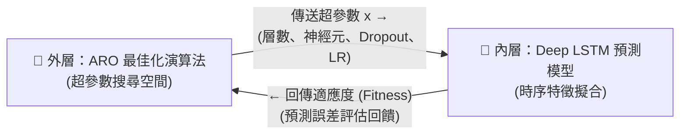

# 《以人工兔群最佳化演算法優化深度 LSTM 之股價預測》
## 簡報完整內容、數學公式推導與學術背景全解手冊

> **本手冊依據文獻原著與簡報 39 頁完整架構進行系統性整理：**
> * 原著論文：Gülmez, B. (2023). *Stock price prediction with optimized deep LSTM network with artificial rabbits optimization algorithm*. **Expert Systems with Applications**, 227, 120346.
> * DOI：[10.1016/j.eswa.2023.120346](https://doi.org/10.1016/j.eswa.2023.120346)

---

## 目錄 (Table of Contents)
1. [研究背景與核心問題 (Slides 1–4)](#1-研究背景與核心問題-slides-14)
2. [資料工程與滑動視窗機制 (Slide 5)](#2-資料工程與滑動視窗機制-slide-5)
3. [實驗設計與對照基準模型 (Slide 6, 15)](#3-實驗設計與對照基準模型-slide-6-15)
4. [深度 LSTM 神經網路原理與數學公式 (Slides 7–14)](#4-深度-lstm-神經網路原理與數學公式-slides-714)
5. [人工兔群最佳化演算法 (ARO) 數學公式詳解 (Slides 16–21)](#5-人工兔群最佳化演算法-aro-數學公式詳解-slides-1621)
6. [LSTM-ARO 整合架構與超參數搜尋空間 (Slides 22–25)](#6-lstm-aro-整合架構與超參數搜尋空間-slides-2225)
7. [預測評估指標與數學定義 (Slide 26)](#7-預測評估指標與數學定義-slide-26)
8. [實證成果、個股數據與例外深度分析 (Slides 27–33)](#8-實證成果個股數據與例外深度分析-slides-2733)
9. [計算複雜度與算力成本分析 (Slides 34–35)](#9-計算複雜度與算力成本分析-slides-3435)
10. [學術討論、研究限制與再現性檢驗 (Slides 36–38)](#10-學術討論研究限制與再現性檢驗-slides-3638)
11. [全簡報 39 頁投影片逐頁對照索引表 (Slide-by-Slide Matrix)](#11-全簡報-39-頁投影片逐頁對照索引表)

---

## 1. 研究背景與核心問題 (Slides 1–4)

### 1.1 研究核心動機
金融股票市場具有高度**非線性 (Non-linearity)**、**非平穩性 (Non-stationarity)** 以及顯著的**時間依賴性 (Temporal Dependency)**。預測隔日股票價格面臨兩大核心瓶頸：
1. **特徵捕捉難題**：單日股價並非獨立同分布（i.i.d.）樣本，歷史價格的時間序列先後順序包含市場動量與資訊反饋。
2. **模型調參難題**：深度長短期記憶神經網路（Deep LSTM）雖然具備強大的時序記憶捕捉能力，但其預測精度極度依賴於超參數（層數、神經元數、正規化參數、優化器、學習率）。若僅以經驗法則或網格搜尋（Grid Search）暴力調參，容易陷入局部最佳解（Local Minima）或因計算爆炸而無法收斂。

### 1.2 相關技術脈絡比較 (Slide 4)
* **傳統統計時間序列模型 (ARIMA、GARCH 等)**：善於捕捉線性趨勢與自相關結構，但對高度劇烈的非線性市場波動無能為力。
* **深度循環模型 (RNN / LSTM)**：透過內部狀態向量與門控單元捕捉長短期動態，但模型架構極易發生過擬合（Overfitting）或欠擬合（Underfitting）。
* **元啟發式演算法 (Metaheuristic Optimization)**：將超參數配置抽象化為多維搜尋空間中的尋優問題，打破傳統試誤法，自動尋找最佳架構。

### 1.3 雙層最佳化閉環架構 (Slides 2–3)
本篇論文提出以 **LSTM-ARO** 為核心的雙層閉環系統：
* **外層搜尋層（ARO 兔群演算法）**：
  * 在多維超參數空間中探索，提出候選解向量 $x = [n_1, k_2, n_2, k_3, n_3, d, \text{Dropout}, \text{Optimizer}, \text{LR}]$。
  * 透過「繞路覓食」與「隨機躲藏」行為更新候選參數。
* **內層擬合層（Deep LSTM 模型）**：
  * 接收外層送來的超參數建立網路，以歷史滑動視窗資料進行模型訓練。
  * 產出隔日預測價 $\hat{y}$，並將模型驗證適應度（Fitness，以 MSE 評估）回傳給外層 ARO，作為兔群適應度評分的依據。

---

## 2. 資料工程與滑動視窗機制 (Slide 5)

### 2.1 資料集規範 (DJIA 30)
* **研究標的**：道瓊工業平均指數（Dow Jones Industrial Average, DJIA）全體 30 檔成分股（如 AAPL、MSFT、UNH、CAT、CVX 等），涵蓋科技、醫療、金融、重工業、消費品等多個產業。
* **資料期間**：2017 年 1 月 1 日 至 2021 年 12 月 31 日（共 5 年交易日資料，約 1,259 筆連續交易日收盤價）。
* **資料切分原則**：
  * 前 80% 資料（約 1,007 個交易日）作為模型訓練集（Training Set）。
  * 後 20% 資料（約 252 個交易日）作為模型無窺探測試集（Testing Set）。

### 2.2 滑動視窗 (Sliding Window) 構建
為了將非監督的時間序列資料轉換為監督式學習（Supervised Learning）之輸入／輸出配對，研究採用長度為 $W = 20$ 的固定滑動視窗：

$$X_k = [p_k, p_{k+1}, p_{k+2}, \dots, p_{k+19}]^T \in \mathbb{R}^{20 \times 1}$$

$$Y_k = p_{k+20} \in \mathbb{R}$$

* **輸入特徵**：過去連續 20 個交易日的收盤價序列。
* **預測目標**：第 21 個交易日的次日收盤價。
* **步長滑動**：視窗每次向後推進 1 個交易日，從中滾動生成訓練與測試樣本。

---

## 3. 實驗設計與對照基準模型 (Slide 6, 15)

論文設計了嚴謹的多模型橫向評測體系，共納入六大模型族群：

| 模型代號 | 網路架構 | 超參數搜尋方式 | 特點與定位 |
| :--- | :--- | :--- | :--- |
| **ANN** | 靜態全連接神經網路 | 固定預設 | 最基礎對照組，無時序記憶狀態，推論耗時最短（136.5s） |
| **LSTM1D** | 單層 LSTM + Dense | 人工固定（10神經元） | 基準單層時序模型，無演化搜尋機制（Table 2 基準） |
| **LSTM2D** | 雙層堆疊 LSTM + Dense | 人工固定（10+10神經元） | 基準雙層深層模型，捕捉中階特徵（Table 3 基準） |
| **LSTM3D** | 三層堆疊 LSTM + Dense | 人工固定（10+10+10神經元） | 基準三層深層模型，參數量達 2,281（Table 4 基準） |
| **LSTM-GA** | 可變層數深度 LSTM | **遺傳演算法 (GA)** | 主流元啟發比較組，透過交配與突變搜尋超參數 |
| **LSTM-ARO** | 可變層數深度 LSTM | **人工兔群演算法 (ARO)** | **本文提出之核心方法**，透過繞路與躲藏平衡探索與開發 |

### 3.1 比較組：遺傳演算法 (GA) 運作流程 (Slide 15)
1. **染色體編碼 (Chromosome)**：將超參數編碼為離散向量（例如 $[n_1, n_2, n_3, d, \text{Dropout}, \text{Opt}, \text{LR}]$）。
2. **適應度評估 (Fitness Evaluation)**：在驗證集上計算各染色體對應模型的 MSE。
3. **選擇 (Selection)**：依適應度以輪盤賭法（Roulette Wheel）保留優秀個體。
4. **單點交配 (Crossover)**：隨機挑選切點，將爸爸（Parent A）與媽媽（Parent B）的染色體前後拼接，形成子代模型。
5. **隨機突變 (Mutation)**：以微小機率（如 0.01）隨機替換某個基因值，維持族群多樣性。

---

## 4. 深度 LSTM 神經網路原理與數學公式 (Slides 7–14)

### 4.1 從 ANN、RNN 到 LSTM (Slide 7)
* **ANN (人工神經網路)**：前饋傳遞，假設各樣本相互獨立，無法捕捉上下文。
* **RNN (循環神經網路)**：導入隱藏狀態 $h_t$，但因隨時間反向傳播（BPTT）中的梯度連乘效應，極易面臨**梯度消失 (Vanishing Gradient)** 或**梯度爆炸 (Exploding Gradient)**，無法記憶超過 10 步以上的歷史依賴。
* **LSTM (長短期記憶網路)**：由 Hochreiter & Schmidhuber (1997) 提出，核心創新是引進「單元狀態（Cell State, $C_t$）」這條專用傳送帶，並藉由三個精巧的「門控單元（Gates）」以加法形式更新記憶，從數學上徹底阻斷梯度指數衰減。

### 4.2 LSTM 內部門控數學公式推導 (Eqs. 1–5 / Slides 8–11)

一個標準的 LSTM Cell 在時間步 $t$（$t \in \{1, \dots, 20\}$）接收當前輸入向量 $x_t \in \mathbb{R}^d$ 與上一時間步的隱藏狀態 $h_{t-1} \in \mathbb{R}^h$，其運算依序包含五大核心公式：

#### (1) 忘記門 (Forget Gate, $f_t$)
控制上一時刻的長期記憶 $C_{t-1}$ 有多少比例應該被遺忘：

$$f_t = \sigma\left(W_f \cdot [h_{t-1}, x_t] + b_f\right)$$

* $\sigma(z) = \frac{1}{1 + e^{-z}}$：Sigmoid 激活函數，將輸出值嚴格壓縮至 $[0, 1]$ 區間。
* $f_t \to 0$ 代表完全丟棄舊記憶；$f_t \to 1$ 代表完全保留。

#### (2) 輸入門 (Input Gate, $i_t$) 與候選記憶 ($\tilde{C}_t$)
決定當前輸入資訊中有多少新內容應寫入長期記憶：

$$i_t = \sigma\left(W_i \cdot [h_{t-1}, x_t] + b_i\right)$$

$$\tilde{C}_t = \tanh\left(W_c \cdot [h_{t-1}, x_t] + b_c\right)$$

* $i_t \in [0, 1]$：輸入門閥門開度。
* $\tanh(z) = \frac{e^z - e^{-z}}{e^z + e^{-z}} \in [-1, 1]$：候選記憶資訊，規範數值中心化於 0。

#### (3) 單元狀態更新 (Cell State Update, $C_t$)
將「遺忘後的舊記憶」與「篩選後的新資訊」以**線性加法**結合，這是 LSTM 避免梯度消失的關鍵所在：

$$C_t = f_t \odot C_{t-1} + i_t \odot \tilde{C}_t$$

* $\odot$ 代表 Hadamard 積（逐元素相乘，Element-wise Product）。

#### (4) 輸出門 (Output Gate, $o_t$)
決定當前更新後的長期狀態 $C_t$ 中，有哪些部分應轉換為當前的隱藏輸出：

$$o_t = \sigma\left(W_o \cdot [h_{t-1}, x_t] + b_o\right)$$

#### (5) 隱藏狀態輸出 (Hidden State Output, $h_t$)
產出傳遞至下一時間步（橫向）或下一神經網路層（縱向）的輸出向量：

$$h_t = o_t \odot \tanh(C_t)$$

---

### 4.3 投影片數值算例逐步推導 (Slide 11)
簡報第 11 頁以純量數值直觀示範了上述公式的運作流程：
* **已知輸入條件**：
  * 前一步長期記憶 $C_{t-1} = 0.820$
  * 忘記門開度 $f_t = 0.700$
  * 輸入門開度 $i_t = 0.500$
  * 候選新資訊 $\tilde{C}_t = 0.600$
  * 輸出門開度 $o_t = 0.800$

* **逐步運算**：
  1. **保留舊記憶**：$f_t \times C_{t-1} = 0.700 \times 0.820 = 0.574$
  2. **寫入新資訊**：$i_t \times \tilde{C}_t = 0.500 \times 0.600 = 0.300$
  3. **新單元狀態**：$C_t = 0.574 + 0.300 = \mathbf{0.874}$
  4. **非線性轉換**：$\tanh(0.874) = \frac{e^{0.874} - e^{-0.874}}{e^{0.874} + e^{-0.874}} \approx 0.7034$
  5. **隱藏狀態輸出**：$h_t = 0.800 \times 0.7034 = \mathbf{0.5627} \approx 0.563$

---

### 4.4 時間展開與時空雙向資訊流 (Slides 12–13)
* **時間展開 (Time Unrolling, Slide 12)**：
  在長度為 20 的滑動視窗中，同一個 LSTM Cell 沿 $t = 1, 2, \dots, 20$ 連續展開 20 次。**特別注意：這 20 個時間步共享同一組權重矩陣 $\{W_f, W_i, W_c, W_o\}$**，參數不會隨時間步長增加。
* **時間 × 深度 雙向資訊流 (Slide 13)**：
  * **橫向（時序依賴流）**：同層 Cell 之間傳遞隱藏狀態與單元狀態 $h_{t-1}^{\langle l \rangle} \to h_t^{\langle l \rangle}$。
  * **縱向（特徵抽象流）**：下層 LSTM 在 $t$ 時刻產生的隱藏輸出作為上層 LSTM 的輸入 $h_t^{\langle l-1 \rangle} \to x_t^{\langle l \rangle}$。

---

### 4.5 深度神經網路參數量精確計算公式 (Slide 14 / Tables 2–4, 6)
理解模型參數量是評估過擬合風險與算力開銷的關鍵：

#### (1) LSTM 層可訓練參數量公式
每個 LSTM Cell 包含 4 個前饋全連接結構（忘記門、輸入門、候選狀態、輸出門），每個結構均包含輸入權重矩陣、循環隱藏權重矩陣與偏差項：

$$\text{Params}_{\text{LSTM}} = 4 \times \left[ (d_{\text{in}} + d_{\text{out}}) \times d_{\text{out}} + d_{\text{out}} \right] = 4 \times d_{\text{out}} \times (d_{\text{in}} + d_{\text{out}} + 1)$$

* $d_{\text{in}}$：該層輸入特徵維度。
* $d_{\text{out}}$：該層神經元數量（Hidden Units）。

#### (2) 全連接層 (Dense) 參數量公式
$$\text{Params}_{\text{Dense}} = (d_{\text{in}} + 1) \times d_{\text{out}}$$

#### (3) 論文固定基準架構逐層參數推導 (Tables 2–4)
* **Table 2 · LSTM1D 基準模型**（輸入維度 1，LSTM 10 神經元，Dense 10 神經元，輸出 1）：
  * $\text{LSTM}_1$：$4 \times [(1 + 10) \times 10 + 10] = 4 \times 120 = 480$
  * $\text{Dense}$：$(10 + 1) \times 10 = 110$
  * $\text{Output}$：$(10 + 1) \times 1 = 11$
  * **總參數量**：$480 + 110 + 11 = \mathbf{601}$ 個參數。
* **Table 3 · LSTM2D 基準模型**（在 1D 基礎上堆疊第二層 10 神經元 LSTM）：
  * $\text{LSTM}_1$：$480$
  * $\text{LSTM}_2$：$4 \times [(10 + 10) \times 10 + 10] = 4 \times 210 = 840$
  * $\text{Dense} + \text{Output}$：$110 + 11 = 121$
  * **總參數量**：$480 + 840 + 121 = \mathbf{1,441}$ 個參數。
* **Table 4 · LSTM3D 基準模型**（堆疊第三層 10 神經元 LSTM）：
  * $\text{LSTM}_1$：$480$
  * $\text{LSTM}_2$：$840$
  * $\text{LSTM}_3$：$4 \times [(10 + 10) \times 10 + 10] = 840$
  * $\text{Dense} + \text{Output}$：$121$
  * **總參數量**：$480 + 840 + 840 + 121 = \mathbf{2,281}$ 個參數。

---

## 5. 人工兔群最佳化演算法 (ARO) 數學公式詳解 (Slides 16–21)

人工兔群最佳化（Artificial Rabbits Optimization, ARO）是由 Wang et al. 於 2022 年發表在頂級計算機期刊的高效元啟發演算法。其核心模擬野兔在自然界中的生存適應行為：**野兔為了避免暴露自身巢穴，絕不在自己洞穴附近吃草，而是奔跑至遠處草地「繞路覓食」（全域探索）；當遭遇天敵追擊時，隨機在各維度挖掘的多個洞穴中「隨機躲藏」（局部開發）**。

### 5.1 能量因子公式 (Energy Factor $A(t)$, Eqs. 19–20 / Slide 21)
能量因子 $A(t)$ 負責動態調控演算法在「全域探索」與「局部微調」之間的轉換平衡：

$$A(t) = 4 \left(1 - \frac{t}{T}\right) \ln\left(\frac{1}{r}\right)$$

* $t$：當前迭代次數（$1 \le t \le T$，$T = 50$）。
* $T$：演算法最大迭代總次數。
* $r \in (0, 1)$：均勻分布隨機浮點數。
* **物理與搜尋意涵**：
  * 當迭代初期（$t/T$ 較小）時，$(1 - t/T)$ 接近 1，使得 $A(t) > 1$ 的機率極高，兔群全面啟動**繞路覓食（Exploration）**，大範圍跳躍至未知超參數解空間。
  * 當迭代後期（$t/T \to 1$）時，能量因子衰退，$A(t) \le 1$ 的機率居主導地位，兔群轉入**隨機躲藏（Exploitation）**，在已知最優解鄰域進行細部微調。

---

### 5.2 繞路覓食數學公式 (Detour Foraging, Eqs. 6–11 / Slides 17–18)
當 $A(t) > 1$ 時，第 $i$ 隻兔子會參考群體中另一隻隨機兔子 $j$（$j \ne i$）的位置進行長距離奔馳更新：

$$v_i(t+1) = x_j(t) + R \cdot \left(x_i(t) - x_j(t)\right) + \text{round}\left(0.5(0.05 + r_1)\right) \cdot n_1$$

各組成數學項嚴格定義如下：
1. **$x_i(t)$ 與 $x_j(t)$**：分別代表當前第 $i$ 隻兔子與隨機挑選的參考同伴 $j$ 的 $D$ 維位置向量（即一組超參數解）。
2. **跑動步長矩陣 $R$ (Eq. 7)**：
   $$R = L \cdot c$$
   * **奔跑長度 $L$ (Eq. 8)**：
     $$L = \left(e - e^{\left(\frac{t-1}{T}\right)^2}\right) \cdot \sin(2\pi r_2)$$
     其中 $r_2 \in (0, 1)$。隨時間進行，指數項使奔跑幅度逐步縮小。
   * **維度選擇遮罩矩陣 $c$ (Eqs. 9–11)**：
     $$c(k) = \begin{cases} 1 & \text{若 } k == g(l), \quad l = 1, \dots, \lceil r_3 \cdot D \rceil \\ 0 & \text{否則} \end{cases}$$
     $c$ 是一個二元遮罩向量，由隨機排列函數決定本次要更新的特定超參數維度，保持其他維度不變，防止高維度空間搜尋的維度災難。
3. **隨機擾動項 (Random Perturbation, Slide 18)**：
   $$q = \text{round}\left(0.5(0.05 + r_1)\right), \quad r_1 \in (0, 1)$$
   $$n_1 \sim \mathcal{N}(0, 1)$$
   * 由於 $0.5 \times (0.05 + r_1)$ 的最大值為 $0.5 \times 1.05 = 0.525$，經四捨五入 $\text{round}(\cdot)$ 運算後：
     * 當 $r_1 < 0.95$ 時，$0.5(0.05 + r_1) < 0.5 \implies q = 0$（不觸發擾動）。
     * **只有當 $r_1 \ge 0.95$（約 5% 機率）時**，$0.5(0.05 + r_1) \ge 0.5 \implies q = 1$。
   * 此時將引入服從標準常態分布 $\mathcal{N}(0, 1)$ 的擾動值 $n_1$，賦予兔子跳脫局部最佳解（Escape from Local Optima）的變異能力。

---

### 5.3 隨機躲藏數學公式 (Random Hiding, Eqs. 12–18 / Slides 19–20)
當 $A(t) \le 1$ 時，第 $i$ 隻兔子面臨掠食壓力，在每個維度周遭挖掘一個候選隱蔽洞穴：

#### (1) 候選洞穴生成公式 (Eq. 13 / Slide 19)
$$b_{i,j}(t) = x_i(t) + H \cdot g_j \cdot x_i(t), \quad j = 1, \dots, D$$

* $b_{i,j}(t)$：第 $i$ 隻兔子在第 $j$ 個維度所生成的候選洞穴位置。
* $g_j$：標準基底向量（第 $j$ 維為 1，其餘維度為 0），確保每個洞穴只針對單一維度展開探索。

#### (2) 隱蔽半徑係數 $H$ (Eq. 14 / Slide 20)
$$H = \left(\frac{T - t + 1}{T}\right) \cdot r_4, \quad r_4 \in (0, 1)$$

* 隨迭代次數 $t$ 由 1 推進至 $T$，$((T - t + 1) / T)$ 從 1 線性衰減至 $1/T \approx 0$。
* 這意味著在前期洞穴半徑廣大，後期洞穴緊密貼附於兔子自身位置，實現高精度的數值收斂。

#### (3) 躲藏洞穴位置更新 (Eqs. 15–18)
兔子從其 $D$ 個洞穴中隨機選取一個洞穴 $b_{i,r}(t)$（$r \in \{1, \dots, D\}$）進行移動：

$$v_i(t+1) = x_i(t) + R \cdot \left(r_5 \cdot b_{i,r}(t) - x_i(t)\right)$$

其中 $r_5 \in (0, 1)$ 控制朝洞穴靠攏的隨機權重。

---

### 5.4 貪婪選擇準則 (Greedy Selection, Slide 18)
不論是繞路覓食還是隨機躲藏產生的候選解向量 $v_i(t+1)$，都必須通過嚴格的貪婪準則檢驗：

$$x_i(t+1) = \begin{cases} v_i(t+1) & \text{若 } f(v_i(t+1)) < f(x_i(t)) \\ x_i(t) & \text{否則} \end{cases}$$

* $f(\cdot)$ 為適應度目標函數（即訓練 LSTM 後在測試資料上的均方誤差 MSE）。
* **保證特性**：只有當候選超參數能使 LSTM 的預測誤差降低時，兔子才會更新位置；否則堅守原地，確保族群歷史最佳解永不倒退。

---

## 6. LSTM-ARO 整合架構與超參數搜尋空間 (Slides 22–25)

### 6.1 論文 Table 6 超參數搜尋空間規範
論文將深度 LSTM 網路的所有關鍵設計參數納入 ARO 的多維搜尋向量中，嚴格定義如下：

| 超參數名稱 | 符號／變數 | Table 6 合法範圍 | 步幅／類型 | 在模型中的作用 |
| :--- | :--- | :--- | :--- | :--- |
| **LSTM 第 1 層神經元** | $n_1$ | **1 ～ 20** | 整數（步幅 1） | 基礎特徵萃取容量 |
| **LSTM 第 2 層啟用開關** | $k_2$ | **{0, 1}** | 離散開關（二元變數） | 控制是否構建 2D 深度架構 |
| **LSTM 第 2 層神經元** | $n_2$ | **1 ～ 20** | 整數（若 $k_2=0$ 則停用） | 中階時序抽象容量 |
| **LSTM 第 3 層啟用開關** | $k_3$ | **{0, 1}** | 離散開關（二元變數） | 控制是否構建 3D 深度架構 |
| **LSTM 第 3 層神經元** | $n_3$ | **1 ～ 20** | 整數（若 $k_3=0$ 則停用） | 高階時序抽象容量 |
| **全連接層神經元** | $d$ | **1 ～ 20** | 整數（步幅 1） | 特徵降維與非線性映射 |
| **隨機丟棄率** | $\text{Dropout}$ | **0.30 ～ 0.70** | 浮點數（步幅 0.05） | 隨機斷開連接，防止過擬合 |
| **優化演算法** | $\text{Optimizer}$ | **5 種** | 離散選單：Adam, Adagrad, Adamax, RMSprop, SGD | 權重梯度下降更新規則 |
| **初始學習率** | $\text{Learning Rate}$ | **5 種** | 離散選單：0.01, 0.001, 0.0001, 0.00001, 0.000001 | 權重更新之步長尺度 |

### 6.2 5 階段完整調參閉環流程 (Slide 24)
整個 LSTM-ARO 系統依照以下五大步驟滾動執行：
1. **族群初始化 (Population Initialization)**：在 Table 6 搜尋空間內隨機生成 50 隻兔子個體。
2. **架構解碼與建構 (Model Decoding)**：將每隻兔子的連續/離散位置向量解碼為具體的 Keras 模型結構。
3. **訓練與適應度計算 (Training & Fitness Evaluation)**：以歷史 80% 交易日資料訓練各網路，以 20% 測試集之 MSE 作為適應度分數 $f(x_i)$。
4. **ARO 演化更新 (ARO Evolution Loop)**：
   * 計算能量因子 $A(t)$。
   * 若 $A(t) > 1$，執行繞路覓食（探索全新架構）；若 $A(t) \le 1$，執行隨機躲藏（微調現有架構）。
   * 貪婪選擇接受更低 MSE 的新架構。
5. **最優解收斂 (Optimal Convergence)**：重複迭代 50 代後，輸出全域最佳兔子向量，建立最終實盤預測模型。

---

## 7. 預測評估指標與數學定義 (Slide 26)

論文採用四項統計指標，全面檢驗模型的點預測精度、相對偏差尺度與整體擬合優度（Eqs. 21–24）：

### 7.1 均方誤差 (Mean Squared Error, MSE, Eq. 21)
$$\text{MSE} = \frac{1}{n} \sum_{k=1}^n \left(y_k - \hat{y}_k\right)^2$$

* $y_k$：第 $k$ 筆真實價格；$\hat{y}_k$：第 $k$ 筆模型預測價格；$n$：測試樣本總筆數。
* **特性**：誤差項經平方處理，**對大離群值（Outliers）極度敏感並施加強烈懲罰**。在金融預測中，能有效防止模型產生嚴重偏離行情的巨幅失誤。論文中直接以 MSE 作為 ARO 與 GA 的最佳化適應度函數。

### 7.2 平均絕對誤差 (Mean Absolute Error, MAE, Eq. 22)
$$\text{MAE} = \frac{1}{n} \sum_{k=1}^n \left|y_k - \hat{y}_k\right|$$

* **特性**：以真實美元價值反映預測誤差的平均物理尺度。相較於 MSE，MAE 具有強健性（Robustness），不會過度受到單一極端震盪日的扭曲。

### 7.3 平均絕對百分比誤差 (Mean Absolute Percentage Error, MAPE, Eq. 23)
$$\text{MAPE} = \frac{100\%}{n} \sum_{k=1}^n \left| \frac{y_k - \hat{y}_k}{y_k} \right| \quad (y_k \ne 0)$$

* **特性**：消除各檔股票絕對價格的量綱影響（例如 UNH 股價在 \$400 以上，而平價股在 \$50 左右），提供跨股票之間公平評比的相對百分比指標。

### 7.4 決定係數 (Coefficient of Determination, $R^2$, Eq. 24)
$$R^2 = 1 - \frac{\text{SSE}}{\text{SST}} = 1 - \frac{\sum_{k=1}^n (y_k - \hat{y}_k)^2}{\sum_{k=1}^n (y_k - \bar{y})^2}$$

* $\bar{y} = \frac{1}{n} \sum_{k=1}^n y_k$：真實收盤價之樣本平均值。
* $\text{SSE} = \sum_{k=1}^n (y_k - \hat{y}_k)^2$：模型殘差平方和。
* $\text{SST} = \sum_{k=1}^n (y_k - \bar{y})^2$：總變異平方和（以恆等於均值的「無腦預測器」作為基準）。
* **特性**：$R^2$ 衡量模型能夠解釋真實股價波動變異的百分比。$R^2$ 越接近 1，代表預測曲線與真實價格走勢擬合度越高。

---

## 8. 實證成果、個股數據與例外深度分析 (Slides 27–33)

### 8.1 30 檔股票橫向綜合勝出統計 (Tables 7–10 / Slides 27–31)
論文對道瓊 30 檔股票分別獨立執行完整調參訓練，統計各大模型奪得全場最佳數值的次數：

| 評估指標 | LSTM-ARO (本文方法) | LSTM-GA | LSTM1D | 結論評析 |
| :---: | :---: | :---: | :---: | :--- |
| **最低 MSE** | **18 檔 (60.0%)** | 10 檔 (33.3%) | 2 檔 (6.7%) | ARO 展現絕對優勢，在六成標的壓制 GA |
| **最低 MAE** | **17 檔 (56.7%)** | 11 檔 (36.7%) | 2 檔 (6.7%) | 實質美元價格偏差最小 |
| **最低 MAPE** | **18 檔 (60.0%)** | 9 檔 (30.0%) | 3 檔 (10.0%) | 相對百分比誤差全面領先 |
| **最高 $R^2$** | **17 檔 (56.7%)** | 10 檔 (33.3%) | 3 檔 (10.0%) | 走勢變異解釋能力最高 |

* **重要發現**：固定架構模型（如 LSTM1D）偶爾能勝出 2~3 檔，但全面落後於自動搜尋模型；而 LSTM-ARO 在所有指標均以約 60% 的壓倒性優勢位居第一。

---

### 8.2 代表性成分股實測數值對比 (Slide 28 / Table 7, 10)
下表摘錄簡報與論文重點分析的 5 檔核心股票數據：

| 股票代號 | 公司名稱 | ARO MSE | GA MSE | ARO $R^2$ | GA $R^2$ | 勝出模型與優勢分析 |
| :--- | :--- | :---: | :---: | :---: | :---: | :--- |
| **AAPL** | 蘋果公司 (Apple) | **22.731** | 24.109 | **0.857** | 0.848 | **ARO 勝**（MSE 降低 5.7%） |
| **MSFT** | 微軟公司 (Microsoft) | **63.322** | 79.253 | **0.892** | 0.865 | **ARO 大勝**（MSE 降低 20.1%） |
| **CAT** | 開拓重工 (Caterpillar) | 38.438 | **36.329** | 0.909 | **0.914** | **GA 例外勝**（強景氣循環股） |
| **CVX** | 雪佛龍 (Chevron) | 23.970 | **21.953** | 0.911 | **0.919** | **GA 例外勝**（受能源外生衝擊大） |
| **UNH** | 聯合健康 (UnitedHealth) | 126.133 | **96.373** | 0.823 | **0.865** | **GA 例外勝**（高價股且波動大） |

---

### 8.3 例外案例深度剖析：為何 GA 在 CAT、CVX、UNH 能勝出？(Slide 32)
在學術簡報中，**主動誠實探討例外案例是體現嚴謹度的核心亮點**：
1. **「沒有免費午餐」定理 (No Free Lunch Theorem, NFL)**：
   數學上不存在任何單一元啟發演算法能夠在所有非凸（Non-convex）最佳化問題上均保持 100% 絕對碾壓。
2. **個股波動特徵的差異**：
   * **CAT** 屬於極端景氣循環股，機械訂單週期使價格走勢具有尖銳的局部反轉點。
   * **CVX** 極易受到地緣政治與國際原油期貨等外生變數衝擊，走勢不規則突變多。
   * **UNH** 為高價股（股價逾 \$400），價格波動絕對區間大。
3. **演算法機制的匹配性**：
   GA 的粗暴交叉拼接與突變（Mutation）本質上具有較強的離散隨機跳躍能力，在少數具有多重極端尖峰的解空間盆地中，恰好偶然命中了特殊的超參數組合。

---

### 8.4 實際預測曲線特徵分析 (Slide 33 / Figs. 3–4)
* **1 日滯後現象 (Lag Effect)**：
  金融時間序列模型普遍存在 1 天的滯後反應（即今日強烈反彈，模型在明日才跟隨向上調整），這是利用歷史價格預測未來的固有現象。
* **轉折點擬合**：
  LSTM-ARO 在價格回檔與平台整理區間的殘差波動顯著低於 LSTM-GA，展現出更平滑的趨勢跟隨能力。

---

## 9. 計算複雜度與算力成本分析 (Slides 34–35)

### 9.1 離線超參數搜尋成本 (Offline Search Cost)
* **搜尋設定**：
  * 兔群規模 $N = 50$ 隻兔子。
  * 迭代次數 $T = 50$ 代。
  * 股票總數 = 30 檔。
* **總訓練次數計算**：
  $$\text{Total Trainings} = 50 \times 50 \times 30 = \mathbf{75,000 \text{ 次完整模型訓練}}$$
* **實測耗時 (Table 11)**：
  * **ARO 最佳化搜尋總耗時**：**8.737 天**（約 754,877 秒）。
  * **GA 最佳化搜尋總耗時**：**8.353 天**（約 721,700 秒）。

---

### 9.2 線上推論延遲 (Online Inference Latency)
一旦離線調參完成，鎖定各檔股票的最優超參數權重後，模型在實盤線上推論的時間極短：

| 模型名稱 | 30 檔股票推論總時間 | 平均單檔股票推論時間 |
| :--- | :---: | :---: |
| **ANN** | 136.50 秒 | 約 4.55 秒 |
| **LSTM1D** | 249.60 秒 | 約 8.32 秒 |
| **LSTM-GA** | 288.70 秒 | 約 9.62 秒 |
| **LSTM-ARO** | **301.96 秒** | **約 10.07 秒** |
| **LSTM2D** | 374.30 秒 | 約 12.48 秒 |
| **LSTM3D** | 501.50 秒 | 約 16.72 秒 |

* **核心結論**：**「離線調參成本高昂，線上推論延遲極低」**。8.7 天的搜尋是一次性（One-off）的離線投資，一旦產出權重，線上只需 10 秒即可完成單檔股票預測，完全符合盤後預測次日交易的實務落地需求。

---

## 10. 學術討論、研究限制與再現性檢驗 (Slides 36–38)

在簡報的批判性思考與總結環節，應向聽眾明確闡明本研究的貢獻與限制：

### 10.1 研究限制 (Limitations)
1. **資料切分偏誤 (Fixed Split vs. Walk-Forward)**：
   論文採用固定的 80% 訓練與 20% 測試切分。在金融量化領域，若市場在後 20% 期間處於多頭，而在前 80% 處於盤整，模型可能無法檢驗跨牛熊週期的強健性。採用**前向滾動交叉驗證 (Walk-Forward Validation)** 更能防範資料窺探偏差（Data Snooping Bias）。
2. **預測精度 $\ne$ 量化交易獲利**：
   MSE 降低僅代表統計上的預測誤差縮小，實務交易中若未計入**手續費、證券交易稅、滑價（Slippage）以及借券放空成本**，統計上預測準確的訊號未必能轉換為扣除成本後的實質超額報酬（Alpha）。
3. **外生變數缺席**：
   僅使用單一維度的歷史收盤價，未納入成交量（Volume）、大盤指數、總體經濟指標（利率、通膨）或新聞情緒分析（Sentiment Analysis）。

### 10.2 再現性檢驗清單 (Reproducibility Checklist, Slide 37)
* **論文明確交代者**：
  * 資料來源（Yahoo Finance）、股票代號清單（30 檔成分股）。
  * 滑動視窗大小（$W = 20$）、切分比例（80/20）。
  * 搜尋空間定義（Table 6）、評估指標公式（Eqs. 21–24）。
* **論文未充分披露、有待確認者**：
  * 是否採用 Min-Max 正規化？若有，正規化參數是否僅由訓練集擬合？
  * 訓練時的 Batch Size、Epochs 數與 Early Stopping 條件。
  * 隨機種子（Random Seed）：元啟發演算法具備隨機性，未報告多次重跑之標準差。

---

## 11. 全簡報 39 頁投影片逐頁對照索引表

| 頁碼 | 簡報標題 | 所屬章節 | 核心內容與涉及公式 |
| :---: | :--- | :--- | :--- |
| **P01** | 首頁與題目 | 封面 | 論文題目、作者、期刊與簡報主題介紹 |
| **P02** | 這篇論文想解決什麼問題？ | 01｜研究動機 | 股價非線性時序依賴 vs. LSTM 超參數設定難題 |
| **P03** | 研究貢獻與整體架構 | 01｜研究動機 | 雙層閉環架構（外層 ARO 提出參數 ⇄ 內層 LSTM 回傳適應度） |
| **P04** | 相關研究背景 | 研究背景 | 傳統時間序列 (ARIMA)、深度模型 (LSTM) 與元啟發式調參回顧 |
| **P05** | 資料如何變成 LSTM 輸入？ | 02｜資料與任務 | 滑動視窗機制 ($W=20$)，20 日價格 $\to$ 次日目標，80/20 切分 |
| **P06** | 對照模型：作者比較了哪些方法？ | 02｜實驗設計 | ANN、LSTM 1D/2D/3D、LSTM-GA、LSTM-ARO 對照矩陣 |
| **P07** | ANN、RNN、LSTM 演進脈絡 | 基礎概念 | 前饋無記憶 $\to$ 循環隱藏狀態 $\to$ 門控單元狀態阻斷梯度消失 |
| **P08** | LSTM 為何能記住較久以前的資訊？ | 03｜LSTM 核心概念 | Cell State 專用通道與三個 Gate 的加法更新本質 |
| **P09** | LSTM 單元結構：記憶如何流動 | 03｜LSTM 核心概念 | 忘記門、輸入門、候選記憶、輸出門內部拓撲連通圖解 |
| **P10** | Gate 的內部：每個門如何計算 | 03｜LSTM 核心概念 | $\sigma$ 與 $\tanh$ 激活函數分工，數學公式 (1)～(5) 拆解 |
| **P11** | 帶入數字：一次 LSTM 更新怎麼算 | 03｜LSTM 核心概念 | 數值算例代入（$C_{t-1}=0.82 \to C_t=0.874 \to h_t=0.563$） |
| **P12** | 同一個 LSTM Cell 沿時間展開 | 03｜LSTM 核心概念 | 20 個時間步的展開機制，強調時序權重矩陣完全共享 |
| **P13** | 多層 LSTM：時間 × 深度 兩個方向 | 03｜LSTM 核心概念 | 橫向時間流 $h_{t-1}^{\langle l \rangle}$ 與縱向深度抽象流 $h_t^{\langle l-1 \rangle}$ 的正交架構 |
| **P14** | 論文比較的 1D／2D／3D 架構 | 03｜LSTM 核心概念 | Table 2–4 基準架構，參數量精確推導 (601, 1441, 2281) |
| **P15** | GA 遺傳演算法機制模擬 | 比較方法 | 染色體編碼、輪盤選擇、單點交配剪切、隨機突變 |
| **P16** | ARO：人工兔群最佳化在模仿什麼？ | 04｜ARO 核心概念 | 野兔生態行為：繞路覓食（探索）與隨機躲藏（開發） |
| **P17** | ARO 公式①：繞路覓食 (Exploration) | 04｜ARO 公式 | Eq. (6) 奔跑更新，引力項 $R(x_i-x_j)$ 與步長 $L$ |
| **P18** | ARO 數學細節：步長、遮罩與擾動 | ARO 公式細節 | 遮罩 $c$ 維度選擇、擾動項 $r_1 \ge 0.95 \implies q=1$、貪婪選擇準則 |
| **P19** | ARO 公式②：隨機躲藏 (Exploitation) | 04｜ARO 公式 | Eqs. (12)–(18) 洞穴生成 $b_{i,j}(t) = x_i + H \cdot g_j \cdot x_i$ |
| **P20** | ARO 隨機躲藏：各維度產生候選洞穴 | ARO 公式細節 | 基底向量 $g_j$、隱蔽半徑 $H=((T-t+1)/T)r_4$ 線性收斂至 0 |
| **P21** | ARO 公式③：什麼時候覓食或躲藏？ | 04｜ARO 公式 | Eqs. (19)–(20) 能量因子 $A(t) = 4(1-t/T)\ln(1/r)$，門檻值 1 |
| **P22** | ARO 搜尋空間：論文全部候選值 | 05｜方法整合 | Table 6 搜尋邊界：神經元 1~20、Dropout 0.3~0.7、5 優化器、5 LR |
| **P23** | ARO 搜尋空間：每隻兔子是一套網路 | 方法整合 | 候選解解碼向量 $[n_1, k_2, n_2, k_3, n_3, d, \text{Drop}, \text{Opt}, \text{LR}]$ |
| **P24** | LSTM-ARO 完整運作流程 | 05｜方法整合 | 5 階段完整調參閉環（初始化 $\to$ 建模 $\to$ 訓練 $\to$ 演化 $\to$ 輸出） |
| **P25** | 搜尋的是「可變的多層架構」 | 05｜方法整合 | ARO 負責外層宏觀調參，不干預 LSTM 內部門控微觀權重學習 |
| **P26** | 研究如何衡量預測表現？ | 06｜評估與結果 | 四大誤差指標公式定義：MSE (Eq. 21)、MAE (22)、MAPE (23)、$R^2$ (24) |
| **P27** | 論文結果：誰在 30 檔股票拿下最低 MSE？ | 06｜評估與結果 | Table 7 成果：LSTM-ARO 勝出 18 檔 (60%)，GA 10 檔，1D 2 檔 |
| **P28** | 實際數字：ARO 與 GA 差多少？ | 06｜評估與結果 | AAPL、MSFT、CAT、CVX、UNH 五檔關鍵股票數值精確對標 |
| **P29** | 實驗結果：MAE 30 檔股票比較 | 實驗結果 | Table 8 成果：LSTM-ARO 勝出 17 檔 (56.7%)，美元偏差最小 |
| **P30** | 實驗結果：MAPE 30 檔股票比較 | 實驗結果 | Table 9 成果：LSTM-ARO 勝出 18 檔 (60.0%)，相對百分比最優 |
| **P31** | 實驗結果：$R^2$ 30 檔股票比較 | 實驗結果 | Table 10 成果：LSTM-ARO 勝出 17 檔 (56.7%)，變異解釋力最強 |
| **P32** | 不要只說 ARO 全贏：論文中的例外案例 | 實驗結果 | CAT、CVX、UNH 三檔 GA 勝出案例深度分析與 NFL 定理闡述 |
| **P33** | 預測走勢曲線與殘差擬合 | 實驗結果 | 論文 Figs. 3–4 走勢分析、1 日滯後現象（Lag）與極值貼合度 |
| **P34** | 代價：最佳化過程需要多少時間？ | 06｜評估與結果 | 75,000 次模型訓練分解，搜尋總耗時約 8.74 天 |
| **P35** | 離線超參數搜尋 vs. 最終推論時間 | 實驗結果 | 離線調參（8.7 天）vs. 線上推論（30 檔共 302 秒，每檔 10 秒） |
| **P36** | 討論：結果強，但有哪些需要注意？ | 07｜討論與結論 | 時間序列切分、搜尋預算公平性、預測誤差與交易獲利的鴻溝 |
| **P37** | 研究設計與再現性檢驗 | 討論與限制 | 交代明確項目（視窗、空間）vs. 未披露項目（種子、早停條件） |
| **P38** | 結論：這篇論文真正證明了什麼？ | 07｜討論與結論 | 論文三大核心學術貢獻總結與未來延伸方向 |
| **P39** | Q&A 與參考文獻 | 附錄 | 期刊出處詳細 Citation、DOI 與問答環節 |

